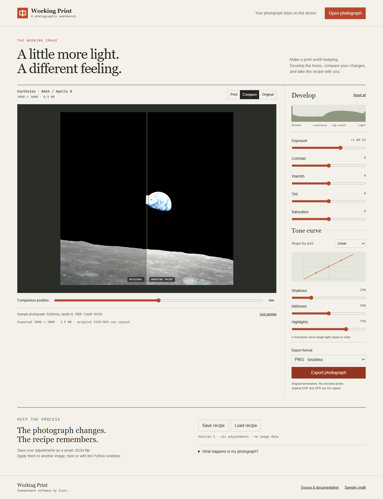

# Working Print

[Open the public demonstration](https://italodevjs.github.io/working-print/) · [Verification record](docs/VERIFICATION.md)

A photographic workbench for adjusting light and colour, comparing the result, and keeping the process as a recipe. It works entirely in your browser. No account, upload service or paid infrastructure is required.



Open a JPEG, PNG or WebP; adjust exposure, contrast, warmth, tint, saturation and a monotonic tone curve; compare the original with a sliding split; export a new PNG or JPEG. Save a versioned JSON recipe and apply it to another photograph. A separate Python renderer implements the same pixel equations for reproducible, scriptable PNG output.

## Run

Requires Node.js 22 or later. There are no npm dependencies or installation step.

```sh
npm run dev
```

Open `http://127.0.0.1:4174`. `npm run build` copies the deployable static application into `dist/`. Any static host can serve it, including GitHub Pages. The development server binds to loopback.

## Use

1. Select **Open photograph**, or drag a file onto the image. The bundled NASA sample lets you explore without supplying a photograph.
2. Adjust the controls. **Print**, **Compare** and **Original** choose the view; the comparison slider also works with a keyboard.
3. Export at the original pixel dimensions. PNG retains transparency; JPEG composites transparency onto white at quality 92. The original file is never changed.
4. Save a recipe to retain exact adjustments. Load it into this workbench or pass it to the Python renderer. The last recipe is also restored from this browser's local storage; no photograph is stored there.

Original EXIF, GPS and device tags are not copied into exports. The application does not invent a camera identity or claim to recreate a camera's physical image pipeline.

## Python reference renderer

Python 3.12 or later is recommended. Create a virtual environment and install `python/requirements.txt`.

```sh
python -m venv .venv
# Windows: .venv\Scripts\activate
# macOS/Linux: source .venv/bin/activate
python -m pip install -r python/requirements.txt
python python/render.py photograph.jpg examples/soft-print.json developed.png
```

The CLI refuses existing output paths. It normalizes EXIF orientation and converts embedded colour profiles to sRGB using Pillow/LittleCMS before rendering. Byte parity tests compare decoded sRGB RGBA arrays, rather than different JPEG decoders or colour-management engines.

## Verification

```sh
npm test
python -m pip install -r python/requirements-dev.txt
python -m pytest -q
```

To include the cross-language parity test, set `WORKING_PRINT_PYTHON` to your Python executable before running `npm test`. Without it, that test is explicitly skipped. CI sets it and runs both suites.

The tests cover identity, linear exposure, desaturation, monotonic curves, transparent pixels, strict recipe rejection, deterministic bounds and JavaScript/Python pixel parity. Browser interaction and screenshots are a separate acceptance gate; passing numerical tests alone does not prove the interface works.
The [verification record](docs/VERIFICATION.md) documents actual browser flows and screenshots. The preview histogram uses logarithmic bin counts so a large dark background does not hide the remaining tonal distribution.

## Technical notes

- [Architecture and algorithms](docs/architecture.md)
- [Study guide and exercises](docs/study-guide.md)
- [Security and privacy](SECURITY.md)
- [AI assistance and provenance](docs/provenance.md)
- [Contributing](CONTRIBUTING.md)

## Limits

Files must be at most 20 MB and 12 megapixels, with no edge above 16,000 pixels. The browser must decode a file before its dimensions can be checked. Preview is downscaled to a maximum 1,400-pixel edge; export renders full resolution. A browser or system with limited memory can still reject a large export.

Processing is bounded 8-bit sRGB. There is no RAW development, HDR recovery, camera calibration, denoising, cropping, image history or batch interface. Warmth/tint are creative channel gains, not measured Kelvin or chromatic adaptation. Piecewise-linear curves can introduce slope discontinuities; this is a transparent, compact operator rather than a laboratory colour-proofing system. Unsupported formats fail explicitly. Animated inputs use the browser's decoded still image.

## Credits and license

The bundled Earthrise photograph is credited to **NASA / Apollo 8 (1968)**. [NASA's image page](https://www.nasa.gov/image-article/apollo-8-earthrise/) and [media usage guidelines](https://www.nasa.gov/nasa-brand-center/images-and-media/) describe the source and permitted use. Its inclusion does not imply NASA endorsement. Code and the original Working Print mark are MIT licensed; NASA imagery is excluded from the MIT grant.
