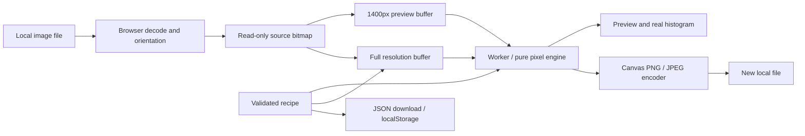

# Architecture

The user story is a file becoming pixels, then a visible adjustment, then a new file. There is no application server, database, account system or third-party runtime request.

## Boundaries

`engine.mjs` is pure numerical code with no browser imports. `worker.mjs` owns the compute message boundary and transfers output buffers. `app.mjs` manages decode, source lifecycle, preview, input validation feedback and downloads. `python/render.py` is an independent NumPy reference implementation for CLI use and parity checks. Python is useful for a vectorized, scriptable reference; it is not required by the hosted application.

The browser has zero runtime packages. Built-in canvas, workers and image decoding are sufficient for this scope. A UI framework or a remote imaging service would add deployment work without improving this image-to-image workflow.

## Pipeline, in order

Inputs are RGBA bytes. Work uses floating-point channels; alpha is copied unchanged.

1. Decode sRGB with its piecewise transfer function: `c / 12.92` below `0.04045`, otherwise `((c + 0.055) / 1.055)^2.4`.
2. Apply exposure gain `2^EV` and creative linear channel gains. For warmth `w` and tint `t` in `[-1, 1]`, gains are `[1 + .22w + .08t, 1 - .12t, 1 - .22w + .08t]`. All remain positive within supported bounds.
3. Clamp linear channels and encode back to sRGB. Clipped highlight detail cannot be recovered.
4. Compute encoded-channel luminance using `[.2126, .7152, .0722]`. Interpolate each channel away from luminance by `1 + saturation/100`. This is a creative saturation operator, not perceptual colour science.
5. Scale contrast around `0.5` by `2^(contrast/50)`, then clamp.
6. Interpolate the tone curve between fixed x coordinates `[0, .25, .5, .75, 1]`. User y coordinates are monotonic, with fixed endpoints 0 and 1. This preserves order without spline overshoot. It does not guarantee smooth first derivatives.
7. Round positive channels with `floor(c * 255 + .5)`. JavaScript uses equivalent `Math.round`. Copy alpha. Build a 64-bin histogram from visible output pixels.

The browser precomputes three 256-entry lookup tables for steps 1–3. These steps depend only on the input byte and recipe, avoiding repeated exponentiation per pixel. Saturation and later stages still run per pixel. Time is O(N), plus a constant-size lookup table; memory is O(N). Preview and export use the same engine, with downscaling as the only preview approximation.

## Asynchrony and ownership

The UI retains one original bitmap. It closes the previous bitmap when a new image loads. The preview buffer is immutable; a copy goes to the worker so repeated adjustments never accumulate rounding error. Preview requests are debounced and tagged; stale responses cannot replace a later preview. Worker processing remains sequential, so heavy queued work may delay a new export rather than run concurrently.

Export snapshots both source pixels and a validated recipe. Later slider changes do not alter that running export. Returned buffers are transferred, not serialized byte by byte. Temporary object URLs are revoked after downloads.

## Recipe contract

Only three top-level fields are accepted: `schema: "working-print"`, `version: 1`, and `adjustments`. The six adjustment keys are mandatory and unknown keys fail. Numbers must be finite and bounded. Curves contain five ordered values in `[0,1]`, starting at 0 and ending at 1. Invalid recipes fail before any active adjustments change. JSON imports have a 32 KB limit.

The recipe contains no image, filename, EXIF, GPS or timestamps. It defines transformations, not an image checksum; applying the same recipe to a different image intentionally produces a different result.

## Colour management and reproducibility

Browser image decoding may convert embedded profiles; canvas operates in its default sRGB space. The Python decoder uses LittleCMS for profiled images. Pixel parity is established after decode, using the same sRGB bytes. File byte identity across browsers, JPEG encoders and profiles is not promised. PNG metadata/chunk details may differ while pixels match.

## Alternatives considered

- A hosted Python imaging API would require upload retention, quotas and compute hosting. Local processing avoids those costs and privacy obligations.
- WebGL could accelerate large images but introduces shader precision, GPU texture-size limits and additional cross-device parity work. A worker and small LUTs meet this bounded scope.
- Cubic splines can be smoother, but arbitrary curves can overshoot and reverse tonal order. A monotonic piecewise-linear mapping is easier to inspect and reproduce.
- Applying exposure directly to encoded sRGB is inexpensive but physically misleading: doubling encoded bytes does not double radiance. Linear exposure is deliberate.

## Known gaps

There is no ICC proofing, wide-gamut export, undo history, RAW support or persistence of image pixels. Browser decoding happens before the dimension gate, and memory limits vary by device. These are explicit scope constraints, not hidden simulated features.
